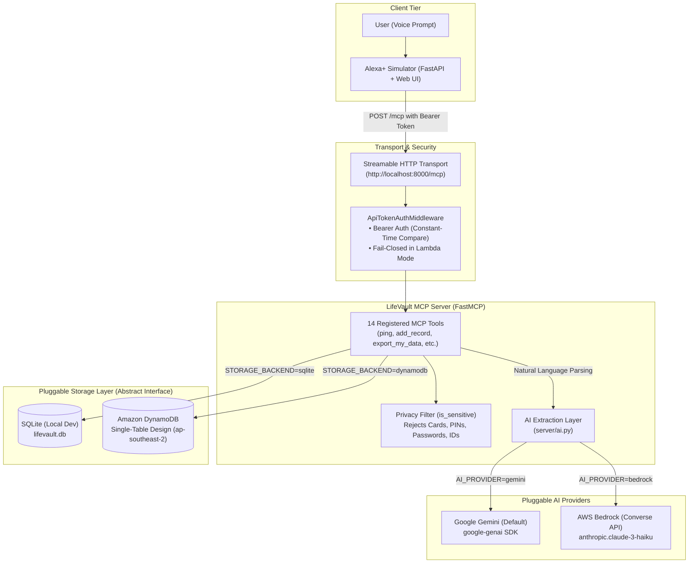

# LifeVault

> **Voice-first life-admin assistant via the Model Context Protocol (MCP)**  
> *"Never miss a warranty, renewal, or deadline again."*

---

## What is LifeVault?

LifeVault is a voice-first life-admin assistant prototype that exposes personal document, warranty, bill, and subscription tracking to conversational clients (such as Alexa+ or the included web simulator) through an open Model Context Protocol (MCP) server. By connecting natural voice queries to an authoritative personal data vault, LifeVault transforms fragmented receipts, policies, and renewal dates into timely spoken answers, proactive morning briefings, and automated claim drafts.

---

## Why Alexa+ Alone Can't Do It

General-purpose voice assistants like Alexa+ are conversational orchestrators, but they face clear limitations when managing personal life administration:

1. **No Access to Private Structured Records**: Conversational models have no native, private store for personal purchase receipts, warranty policies, insurance coverages, or recurring utility invoices.
2. **Lack of Deterministic Date & Money Math**: LLMs frequently make arithmetic errors with calendar dates (e.g., calculating leap years, exact day countdowns, 30-day proactive reminder thresholds, or inflation/anomaly percentage variances).
3. **Proactive Deadline Tracking**: An LLM cannot independently track upcoming expirations without an authoritative backend tracking record lifecycles.
4. **Data Isolation & Portability**: LifeVault keeps records in user-controlled storage (local SQLite or a dedicated DynamoDB single-table backend) accessible via open protocols rather than locking them into proprietary voice silos.

---

## Architecture

The system operates over the standard MCP Streamable HTTP transport with Bearer token security and pluggable AI/storage backends:



---

## The 14 LifeVault Tools

LifeVault exposes 14 specialized MCP tools designed for natural, concise voice responses:

| Tool | Parameters | Description | Example Voice Phrase |
| :--- | :--- | :--- | :--- |
| `ping` | *None* | Health check confirming the LifeVault MCP server is online. | *"Is LifeVault online?"* |
| `add_record` | `type`, `name`, `amount`, `purchase_date`, `warranty_months`, `renewal_cycle`, `vendor`, `notes` | Saves structured record; calculates expiration and 30-day reminder dates. | *"Add a 2-year warranty for my Sony headphones bought yesterday for \$300 from Best Buy."* |
| `add_record_from_text` | `text` | Natural-language parser that extracts fields and saves the record. | *"I just bought a Dell monitor for 400 dollars with a three year warranty."* |
| `find_record` | `query` | Searches records by name, vendor, or notes. Asks clarifying questions on ambiguity. | *"Find my car insurance policy."* |
| `warranty_status` | `item` | Checks whether an item is under warranty, days remaining, or days expired. | *"Is my MacBook still under warranty?"* |
| `upcoming_deadlines` | `days=30` | Lists upcoming warranties, renewals, and bills due within $N$ days. | *"What deadlines are coming up this month?"* |
| `spending_summary` | `period` | Aggregates spend for `"this month"`, `"last month"`, or `"this year"`. | *"How much did I spend on subscriptions last month?"* |
| `delete_record` | `name`, `confirm=False` | Deletes a record with mandatory explicit voice confirmation. | *"Delete my old gym membership."* |
| `export_my_data` | *None* | Exports all stored records for the user as JSON (capped at 100). | *"Export all my stored records."* |
| `delete_all_data` | `confirm=False` | Permanently deletes all records for the user after explicit voice confirmation. | *"Delete all my data from LifeVault."* |
| `renew_record` | `name`, `extend_months`, `new_expiry_date`, `amount` | Extends an existing policy/subscription and recalculates deadlines. | *"Renew my car insurance for another 12 months."* |
| `morning_brief` | *None* | Delivers a daily voice briefing (next 7 days due, recent expirations, bill anomalies). | *"Give me my morning brief."* |
| `draft_warranty_claim`| `item` | Generates a ready-to-send claim email using verified stored record details. | *"Draft a warranty claim for my dishwasher."* |
| `bill_anomalies` | `name=None` | Identifies spikes (> 25% over 3+ past bill median) across recurring utilities. | *"Did my electricity bill spike this month?"* |

---

## AWS Usage & Verification Status

LifeVault supports local execution and cloud architectures:

- **Amazon DynamoDB (Single-Table Design)**:
  - **Region**: `ap-southeast-2` (Sydney), configurable via `AWS_REGION`.
  - **Schema**: Single-table (`lifevault-records`) using partition key `pk` (`USER#default`) and sort key `sk` (`REC#0000000001`).
  - **Atomic Counter**: Monotonically increasing record IDs generated atomically via DynamoDB `ADD last_id :inc` on `sk=COUNTER`.
  - **Verification**: Fully verified locally through automated unit and storage contract tests using `moto.mock_aws`.
- **Amazon Bedrock (Converse API)**:
  - **Implementation**: Enterprise LLM extraction implemented in [`server/ai.py`](file:///c:/Projects/stockpilot-ai/server/ai.py) using the `boto3` Bedrock-Runtime `converse()` API (`anthropic.claude-3-haiku-20240307-v1:0`).
  - **Status**: The code and error-handling paths are fully written. *Bedrock was never run against live AWS to prevent unmocked external cloud charges.*
- **AWS Lambda & Function URL**:
  - **Implementation**: Mangum ASGI adapter in [`deploy/lambda_handler.py`](file:///c:/Projects/stockpilot-ai/deploy/lambda_handler.py) with stateless JSON transport and Function URL support.
  - **Packaging**: Built locally via [`deploy/build.ps1`](file:///c:/Projects/stockpilot-ai/deploy/build.ps1) producing `deploy/package.zip` targeting `python3.13` on `manylinux2014_x86_64`.
  - **Status**: Built and verified locally using 7 tests in `tests/test_lambda_handler.py`. *The Lambda package was tested locally and is NOT deployed to live AWS infrastructure.*

---

## Privacy and Scope

- **What is Stored**: Item names, vendor/merchant, monetary amounts, purchase/expiry/reminder dates, renewal cycles, and optional notes.
- **What is Never Stored**: Credit/debit card numbers (Luhn-valid runs), CVVs, PINs, passwords, bank account/IBAN numbers, and government ID numbers (SSN, Aadhaar, passport).
- **Pattern-Based Filter**: Protection is enforced via a regex and heuristic pattern filter in [`server/privacy.py`](file:///c:/Projects/stockpilot-ai/server/privacy.py). *Notice: This pattern-based filter is not guaranteed against deliberate obfuscation, leetspeak, or novel ID formats.* Users should never submit credentials or sensitive identifiers.
- **Single-User Prototype**: The current implementation is a single-user prototype operating on a single shared partition key (`USER#default`).
- **Production Path**: A production multi-tenant deployment would require user account linking (OAuth 2.0 / Amazon Cognito), per-user partition isolation (`USER#<user_id>`), KMS-managed field-level encryption, and strict automated data retention policies.
- **Data Subject Rights**: `export_my_data` allows users to retrieve all stored records, and `delete_all_data(confirm=True)` allows users to wipe their stored records on demand.

---

## Security Notes

- **Bearer Token Authentication**: When `LIFEVAULT_API_TOKEN` is configured, all HTTP requests to `/mcp` must supply an `Authorization: Bearer <token>` header.
- **Constant-Time Comparison**: Tokens are compared using `hmac.compare_digest` to prevent side-channel timing attacks.
- **Fail-Closed in Cloud Mode**: When `LAMBDA_MODE=1`, if `LIFEVAULT_API_TOKEN` is unset or blank, the server fails closed and rejects all incoming requests with `401 Unauthorized`.
- **Zero Secrets in Repository**: No credentials, API keys, or private tokens exist in the Git history. `.gitignore` excludes `.env*` and `.aws/`.
- **Disclaimer**: LifeVault is an administrative record-keeping prototype and does not provide legal or financial advice.

---

## Quick Start

### 1. Prerequisites
- Python 3.10+
- Google Gemini API key from [Google AI Studio](https://aistudio.google.com/) (free tier available)

### 2. Environment Setup
```powershell
# Clone repository
git clone https://github.com/Adityasaini117/stockpilot-ai.git
cd stockpilot-ai

# Create and activate virtual environment
python -m venv .venv
.\.venv\Scripts\Activate.ps1

# Install dependencies
pip install -r requirements.txt
pip install -r server/requirements.txt
```

Configure `.env`:
```powershell
Copy-Item .env.example .env
```
Ensure `GEMINI_API_KEY` is set in `.env`.

### 3. Seed Database
Populate the database with realistic sample records (laptops, insurance, subscriptions, utilities):
```powershell
python server/seed.py
```

### 4. Run the MCP Server
Start the LifeVault MCP server on port 8000:
```powershell
python server/server.py
```
Server runs at `http://localhost:8000/mcp`.

### 5. Launch the Alexa+ Voice Simulator
In a separate terminal:
```powershell
cd simulator
python app.py
```
Open [http://localhost:8080](http://localhost:8080) in your browser to interact with the voice simulator UI.

---

## Automated Tests

LifeVault has **65 automated unit and contract tests** (verified with pytest):

```powershell
pytest
```

- `tests/test_storage_contract.py` (19 tests): Storage contract tests across SQLite and DynamoDB (via `moto.mock_aws`).
- `tests/test_new_features.py` (20 tests): Tool logic, error isolation, date math, anomaly detection, and voice responses.
- `tests/test_privacy_and_data_tools.py` (19 tests): Sensitive data interception (cards, CVVs, PINs, passwords, SSN, Aadhaar), `export_my_data`, and `delete_all_data`.
- `tests/test_lambda_handler.py` (7 tests): Mangum ASGI adapter, Function URL event handling, Bearer token auth, and fail-closed cloud security.

---

## Project Layout

```text
stockpilot-ai/
├── deploy/
│   ├── build.ps1                       # Windows PowerShell Lambda build script
│   ├── lambda_handler.py               # Mangum ASGI adapter for Lambda Function URL
│   ├── package.zip                     # Pre-built deployment package (tested locally)
│   └── README.md                       # AWS deployment & cloud architecture guide
├── server/
│   ├── ai.py                           # Pluggable AI extraction layer (Gemini & Bedrock)
│   ├── create_table.py                 # DynamoDB table provisioning script
│   ├── privacy.py                      # Heuristic privacy & sensitive data filter
│   ├── requirements.txt                # Server runtime dependencies
│   ├── seed.py                         # Database seeder with realistic test data
│   ├── server.py                       # FastMCP server & 14 tool implementations
│   ├── storage.py                      # Abstract Storage ABC & SQLite implementation
│   └── storage_dynamodb.py             # DynamoDB single-table implementation
├── simulator/
│   ├── static/                         # Simulator web UI assets (HTML/CSS/JS)
│   ├── app.py                          # FastAPI simulator backend
│   ├── llm.py                          # Voice turn handling & Gemini tool dispatch
│   ├── mcp_client.py                   # Streamable HTTP MCP client
│   └── README.md                       # Simulator setup guide
├── tests/
│   ├── test_lambda_handler.py          # Lambda Function URL & auth tests (7 tests)
│   ├── test_new_features.py            # Tool execution & error handling tests (20 tests)
│   ├── test_privacy_and_data_tools.py  # Privacy guardrail & export/delete tests (19 tests)
│   └── test_storage_contract.py        # SQLite & DynamoDB contract tests (19 tests)
├── .env.example                        # Environment variables template
├── SPEC.md                             # LifeVault technical specification
└── README.md                           # Root documentation for judges
```

---

## Separate Simulator Repository

The standalone Alexa+ web simulator is also maintained as an independent open-source repository:  
🔗 [https://github.com/Adityasaini117/lifevault-alexa-simulator](https://github.com/Adityasaini117/lifevault-alexa-simulator)

---

## License

This project is licensed under the [MIT License](file:///c:/Projects/stockpilot-ai/LICENSE).
