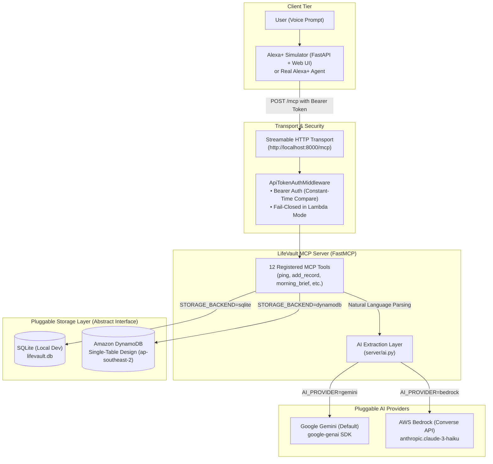

# LifeVault

> **Voice-first life-admin assistant for Alexa+ via the Model Context Protocol (MCP)**  
> *"Never miss a warranty, renewal, or deadline again."*

---

## What is LifeVault?

LifeVault is a voice-first life-admin assistant that exposes private document, warranty, bill, and subscription tracking to Alexa+ through an open Model Context Protocol (MCP) server. By connecting natural voice queries to an authoritative, encrypted personal data vault, LifeVault transforms fragmented receipts, contracts, and renewal dates into timely spoken answers, proactive morning briefings, and automated claim drafts.

---

## Why Alexa+ Alone Can't Do It

General-purpose voice assistants like Alexa+ are powerful conversationalists, but they face inherent limitations when handling personal life administration:

1. **No Access to Private Structured Records**: Alexa+ has no native, private store for personal purchase receipts, warranty policies, insurance limits, or recurring subscription invoices.
2. **Lack of Deterministic Date & Money Math**: LLMs frequently struggle with calendar math (e.g., calculating leap years, exact day countdowns, 30-day proactive reminder thresholds, or inflation/anomaly percentage variances).
3. **Proactive Deadline Tracking**: Alexa+ cannot monitor upcoming expirations without an authoritative backend tracking record lifecycles.
4. **Data Isolation & Portability**: LifeVault keeps records in user-controlled storage (local SQLite or a dedicated DynamoDB single-table backend) accessible via open protocols rather than locking them into proprietary voice silos.

---

## Architecture

The system operates over the standard MCP Streamable HTTP transport with optional Bearer token security and pluggable AI/storage backends:



---

## The 12 LifeVault Tools

LifeVault exposes 12 specialized MCP tools designed for natural, concise voice output:

| Tool | Parameters | Description | Example Voice Phrase |
| :--- | :--- | :--- | :--- |
| `ping` | *None* | Health check confirming server availability. | *"Is LifeVault online?"* |
| `add_record` | `type`, `name`, `amount`, `purchase_date`, `warranty_months`, `renewal_cycle`, `vendor`, `notes` | Saves structured record; calculates expiration and 30-day reminder dates. | *"Add a 2-year warranty for my Sony headphones bought yesterday for \$300 from Best Buy."* |
| `add_record_from_text` | `text` | Natural-language parser that extracts fields and saves the record. | *"I just bought a Dell monitor for 400 dollars with a three year warranty."* |
| `find_record` | `query` | Searches records by name, vendor, or notes. Asks clarifying questions on ambiguity. | *"Find my car insurance policy."* |
| `warranty_status` | `item` | Checks whether an item is under warranty, days remaining, or days expired. | *"Is my MacBook still under warranty?"* |
| `upcoming_deadlines` | `days=30` | Lists upcoming warranties, renewals, and bills due within $N$ days. | *"What deadlines are coming up this month?"* |
| `spending_summary` | `period` | Aggregates spend for `"this month"`, `"last month"`, or `"this year"`. | *"How much did I spend on subscriptions last month?"* |
| `delete_record` | `name`, `confirm=False` | Deletes a record with mandatory explicit voice confirmation. | *"Delete my old gym membership."* |
| `renew_record` | `name`, `extend_months`, `new_expiry_date`, `amount` | Extends an existing policy/subscription and recalculates deadlines. | *"Renew my car insurance for another 12 months."* |
| `morning_brief` | *None* | Delivers a daily voice briefing (next 7 days due, recent expirations, bill anomalies). | *"Give me my morning brief."* |
| `draft_warranty_claim`| `item` | Generates a ready-to-send claim email using verified stored record details. | *"Draft a warranty claim for my dishwasher."* |
| `bill_anomalies` | `name=None` | Identifies spikes (> 25% over 3+ past bill median) across recurring utilities. | *"Did my electricity bill spike this month?"* |

---

## AWS Usage & Verification Status

LifeVault is designed to bridge local development and enterprise AWS serverless cloud deployment:

- **Amazon DynamoDB (Single-Table Design)**:
  - **Region**: `ap-southeast-2` (Sydney), configurable via `AWS_REGION`.
  - **Schema**: Single-table (`lifevault-records`) using partition key `pk` (`USER#default`) and sort key `sk` (`REC#0000000001`).
  - **Atomic Counter**: Monotonically increasing record IDs generated atomically via DynamoDB `ADD last_id :inc` on `sk=COUNTER`.
  - **Verification**: Fully covered and verified via unit tests and automated contract tests using `moto.mock_aws`.
- **Amazon Bedrock (Converse API)**:
  - **Implementation**: Enterprise LLM extraction option implemented in [`server/ai.py`](file:///c:/Projects/stockpilot-ai/server/ai.py) using the `boto3` Bedrock-Runtime `converse()` API (`anthropic.claude-3-haiku-20240307-v1:0`).
  - **Verification Status**: Code is fully implemented with error-handling and fallback logic. *Note: Live API calls were not executed against AWS in CI/test environments to prevent unmocked external cloud charges.*
- **AWS Lambda & Function URL**:
  - **Implementation**: ASGI adapter via Mangum in [`deploy/lambda_handler.py`](file:///c:/Projects/stockpilot-ai/deploy/lambda_handler.py) with stateless JSON transport and DNS rebinding adjustments for Function URLs.
  - **Packaging**: Automated cross-platform packaging script [`deploy/build.ps1`](file:///c:/Projects/stockpilot-ai/deploy/build.ps1) produces `deploy/package.zip` targeting `python3.13` on `manylinux2014_x86_64`.
  - **Verification Status**: Built and verified locally across 7 dedicated test cases simulating Lambda Function URL events; not deployed to live AWS infrastructure.

---

## Security & Privacy

- **Bearer Token Protection**: All MCP interactions over HTTP are protected via `LIFEVAULT_API_TOKEN`.
- **Constant-Time Verification**: Authentication headers are validated using `hmac.compare_digest` to prevent side-channel timing attacks.
- **Fail-Closed in Cloud Mode**: When `LAMBDA_MODE=1`, if `LIFEVAULT_API_TOKEN` is missing, the server fails closed and rejects all requests with `401 Unauthorized`.
- **Zero Secrets in Repository**: No credentials, API keys, or tokens are committed. `.gitignore` strictly excludes `.env*` and `.aws/`.
- **Disclaimer**: LifeVault is a personal life-administration record-keeping tool, not legal or financial advice.

---

## Quick Start

### 1. Prerequisites
- Python 3.10+
- Free Google Gemini API Key from [Google AI Studio](https://aistudio.google.com/)

### 2. Environment Setup
```powershell
# Clone repository
git clone https://github.com/Adityasaini117/stockpilot-ai.git
cd stockpilot-ai

# Create and activate virtual environment
python -m venv .venv
.\.venv\Scripts\Activate.ps1

# Install dependencies
pip install -r requirements.txt
pip install -r server/requirements.txt
```

Configure `.env`:
```powershell
Copy-Item .env.example .env
```
Ensure `GEMINI_API_KEY` is set in `.env`.

### 3. Seed Database
Populate the database with realistic sample records (laptops, insurance, subscriptions, utilities):
```powershell
python server/seed.py
```

### 4. Run the MCP Server
Start the LifeVault MCP server on port 8000:
```powershell
python server/server.py
```
Server runs at `http://localhost:8000/mcp`.

### 5. Launch the Alexa+ Voice Simulator
In a separate terminal:
```powershell
cd simulator
python app.py
```
Open [http://localhost:8080](http://localhost:8080) in your browser to interact with the voice simulator UI.

---

## Automated Tests

LifeVault includes 46 automated unit and contract tests:

```powershell
pytest
```

- `tests/test_storage_contract.py` (19 tests): Verifies storage contracts across both SQLite and DynamoDB (via `moto`).
- `tests/test_new_features.py` (20 tests): Validates all 12 tools, error isolation, date math, anomaly detection, and voice prompts.
- `tests/test_lambda_handler.py` (7 tests): Tests the AWS Lambda Mangum handler, authentication enforcement, and fail-closed security.

---

## Project Layout

```text
stockpilot-ai/
├── deploy/
│   ├── build.ps1             # Windows PowerShell Lambda build script
│   ├── lambda_handler.py     # Mangum ASGI adapter for Lambda Function URL
│   ├── package.zip           # Production Lambda deployment artifact
│   └── README.md             # AWS deployment & cloud architecture guide
├── server/
│   ├── ai.py                 # Pluggable AI extraction layer (Gemini & Bedrock)
│   ├── create_table.py       # DynamoDB table provisioning script
│   ├── requirements.txt      # Server runtime dependencies
│   ├── seed.py               # Database seeder with realistic test data
│   ├── server.py             # FastMCP server & 12 tool implementations
│   ├── storage.py            # Abstract Storage ABC & SQLite implementation
│   └── storage_dynamodb.py   # DynamoDB single-table implementation
├── simulator/
│   ├── static/               # Simulator web UI assets (HTML/CSS/JS)
│   ├── app.py                # FastAPI simulator backend
│   ├── llm.py                # Voice turn handling & Gemini tool dispatch
│   ├── mcp_client.py         # Streamable HTTP MCP client
│   └── README.md             # Simulator setup guide
├── tests/
│   ├── test_lambda_handler.py
│   ├── test_new_features.py
│   └── test_storage_contract.py
├── .env.example              # Environment variables template
├── SPEC.md                   # LifeVault technical specification
└── README.md                 # Root documentation for judges
```

---

## Separate Simulator Repository

The standalone Alexa+ web simulator is also maintained as an independent open-source repository:  
🔗 [https://github.com/Adityasaini117/lifevault-alexa-simulator](https://github.com/Adityasaini117/lifevault-alexa-simulator)

---

## Built with Antigravity

This project was built and refined with **Antigravity**, Google DeepMind's advanced agentic coding assistant. Antigravity was used to:
- Pair-program and architect the pluggable MCP tool interfaces and storage backends.
- Safely diagnose and resolve GitHub push protection issues by cleanly rewriting unpushed Git commits without data loss.
- Verify security boundaries including constant-time token comparison and fail-closed cloud middleware.
- Validate local and AWS Lambda Function URL lifecycles across 46 automated test cases.

---

## License

This project is licensed under the [MIT License](file:///c:/Projects/stockpilot-ai/LICENSE).
